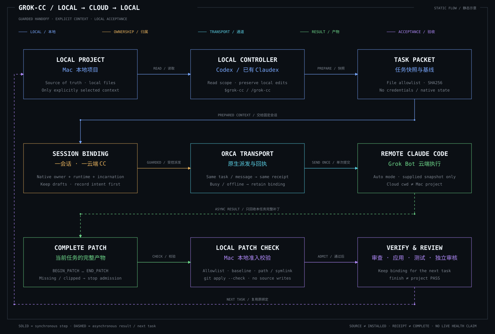

# grok-cc

[简体中文](README.md) | [English](README.en.md)

Author: elvis. Version: `0.1.0.dev3`, a development version with no formal release yet.

Delegate local Mac development tasks to Claude Code on the Grok Bot cloud computer through Orca. Recover the patch, then check, review, apply and test it on the Mac.



[View SVG](docs/assets/architecture.svg) · [Download and open the self-contained HTML locally](docs/architecture.html). This is a workflow diagram, not live service health.

The Mac project is the source of truth. A cloud terminal directory is not the Mac project and does not automatically mount local files. This project does not proxy the Claude API, share login sessions, or configure models, proxies or Tailscale.

## Prerequisites

- Codex or an existing Claudex setup on the Mac. This project does not require a new local Claude login.
- Claude Code already signed in on the cloud computer, with a paired and reachable Orca runtime.
- The Orca CLI for the selected environment. Load its version-matched `orca-cli` guide before using commands.
- Python 3.11 or later and Git; Make for development checks. Helpers use only the Python standard library and rely on POSIX locks and directory file descriptors. The target platforms are macOS and Linux, not native Windows Python.

CI defines a compatibility matrix, but a configured workflow is not evidence that hosted jobs ran. Local tests do not establish network uptime, model access, available quota or external project correctness.

## Usage

After installation into the appropriate Skill entry, invoke it from your actual local conversation:

```text
Codex:   $grok-cc Fix a specific issue in the current project and verify it on the Mac
Claudex: /grok-cc Fix a specific issue in the current project and verify it on the Mac
```

Provide the actual task, allowed files and acceptance criteria. The controller follows [SKILL.md](SKILL.md); example placeholders are not dispatchable tasks. The current Skill instructions and detailed references are in Chinese.

- One real Mac conversation owns one cloud CC terminal. Different conversations do not share terminals.
- Terminal creation requires an explicit user choice. `ensure` verifies an existing binding. Without a binding, first show the read-only plan with `create --project <full cloud worktree ID>`; add `--confirm` only after the user chooses that target. A durable local reservation allows at most one submission per intent in the same registry. There is no native caller-key deduplication, and unknown outcomes never trigger another create.
- Busy, offline, changed identity or unknown send outcomes preserve the existing binding. Do not switch terminals or resend blindly.
- Repeating accepted/uncertain task/message/text resumes its record. Only positively not-started sends allow an explicit same-text retry; a task has at most two submissions including legitimate format exports. Changing IDs cannot bypass this.
- Preserve input drafts. Only verified exact startup hints are recognized before the first task; arbitrary `Try` text is not accepted.
- Require complete task framing, PATCH_SHA256/PATCH_LINES matching original bytes and the original packet's file/baseline/path checks. Legacy output requires explicit `--allow-unhashed`. `input_accepted`, `tui-idle` and screenshots are not acceptance evidence.
- `finish` releases the task slot while preserving its binding. It returns `project_pass=false` and does not establish project completion.

Prepare/render share a default 120 KiB outbound budget and credential scanning; start with a minimal allowlist. Render omits the Mac root and baseline hashes and requests at most ten conclusion lines outside the patch. Optional handoff-summary reports only supplied evidence; missing evidence stays unverified and the helper never writes remotely.

Details: [session binding](references/session-binding.md), [final patch requests and blocker classification](references/final-patch-prompt.md).

## Repository layout

```text
SKILL.md                       Skill entry
agents/openai.yaml             Codex display metadata
references/                    Binding and final patch rules
scripts/session_binding.py     Ownership, locks, idempotence and send guards
scripts/task_packet.py         Explicit snapshots and read-only patch checks
scripts/tests/                 Bundled regression tests
bundle-files.txt               Authoritative installation payload file list
bundle-manifest.json           Version and payload SHA256 values
docs/installation.md           Staging, validation, update and rollback procedure
docs/troubleshooting.md        Known failure mechanisms and capability limits
docs/architecture.html         Self-contained terminal blueprint with inline SVG
docs/assets/architecture.svg   README diagram
```

The initial source baseline preserves all eight existing installed payload files byte for byte. Repository documentation and build files are not installation payload. Private runtime state stays outside the repository.

## Development and verification

From the repository root:

```sh
make check
```

This verifies the eight-file payload list and SHA256 values, runs harmless helper help entrypoints, and executes the complete bundled regression suite. It does not invoke cloud Orca, a model or the shared registry. Tests exercise real temporary files, locks and Git, with a controlled double only at the external Orca boundary. They are not a live cloud end-to-end test.

Individual checks:

```sh
make verify-payload
make smoke
make test
```

After a payload change, complete the relevant tests and independent review before deliberately updating the affected manifest entries and version. Do not regenerate hashes to hide unknown changes. Behavior, identity, security and lifecycle changes require their applicable change scope and authorization first.

GitHub CI runs the same checks on macOS/Linux with Python 3.11/3.13. It does not use cloud credentials, publish or install anything. Actions are pinned to verified upstream commits; see [provenance](PROVENANCE.md).

## Publication and local installation

The local source repository, [GitHub repository](https://github.com/codebyelvis/grok-cc) and active Skill installation have separate acceptance states. Use the actual reviewed Git commit as the installation source after publication, and verify the push and local installation separately. Repository preparation does not automatically update every open conversation.

[Installation documentation](docs/installation.md) reuses the existing official `skill-installer` for isolated staging rather than introducing a second installer. Verify the published revision, installation preimage and concurrent drift before an authorized fixed-payload update. Preserve entry links and runtime state. There is no automatic update/rebind or cleanup. Explicit rebind requires user-confirmed identity and no active/uncertain task.

## License

All rights are currently reserved; see [LICENSE](LICENSE) and [provenance](PROVENANCE.md). An independent source directory does not grant public redistribution rights. The author selects a license before formal release.
